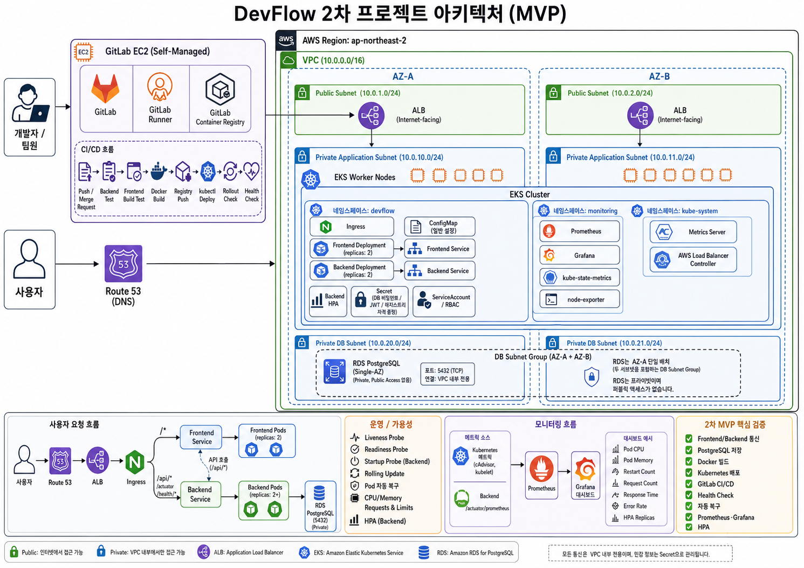

# DevFlow

> **협업이 처음이신가요?** 이슈 생성부터 PR 머지까지 전 과정은 [협업 가이드](./docs/GUIDE.md)를 먼저 읽어주세요.


> **프로젝트·업무 관리와 빌드·배포·운영 상태를 하나의 흐름으로 연결하는 DevOps 통합 프로젝트 관리 시스템**

**DevFlow**는 프로젝트와 업무(Task)를 관리하면서 애플리케이션의 빌드·배포·운영 상태까지 함께 확인할 수 있도록 설계한 서비스입니다.
2차 프로젝트에서는 AWS EKS 위에 애플리케이션을 올리고 GitLab CI/CD, Prometheus, Grafana로 개발부터 배포, 모니터링까지의 흐름을 구성했습니다.
3차 프로젝트에서는 **DevFlow 화면 안에서 파이프라인·배포·Pod·메트릭 상태가 보이도록** 고도화합니다.

- **배포 주소:** 추후 추가
- **시연 영상:** 추후 추가
- **문서 최종 정리일:** `2026-10-11` / **구현 기준일:** `2026-08-12` (2차 프로젝트 기준)

---

## 팀 구성

| 이름 | 역할 | 담당 | GitHub |
|------|------|------|--------|
| 김석현 | 팀장 / Backend | Spring Boot API, 인증/인가(JWT), PostgreSQL, Project/Task 도메인 | [@alberione1110](https://github.com/alberione1110) |
| 이주원 | Frontend | React UI, API 연동, 프로젝트/업무 관리 화면 | [@ssac-JW](https://github.com/ssac-JW) |
| 김민호 | AWS / Kubernetes | Terraform, VPC, EKS, RDS, Kubernetes 리소스 | [@KimMinHo-02](https://github.com/KimMinHo-02) |
| 최윤재 | CI/CD / Monitoring | Self-managed GitLab, Runner, 파이프라인, Prometheus, Grafana | [@cheesemango1](https://github.com/cheesemango1) |

> 2차 프로젝트와 같은 팀원·역할·주제로 이어서 진행합니다.

---

## 빠른 심사 흐름 (5분)

1. 배포된 DevFlow 서비스에 접속합니다.
2. 테스트 계정으로 로그인합니다. (계정 정보는 시연 시 별도 안내)
3. 프로젝트를 생성하고 팀원을 등록합니다.
4. 업무(Task)를 생성하고 담당자와 상태를 지정합니다.
5. GitLab CI/CD 파이프라인으로 Build / Test / Image / Deploy 과정을 확인합니다.
6. EKS에 배포된 Frontend / Backend 상태와 HPA 동작을 확인합니다.
7. Prometheus / Grafana에서 애플리케이션과 클러스터 지표를 확인합니다.

---

## Core Design

- **Application과 DevOps의 통합** — 프로젝트 관리 애플리케이션과 실제 배포·운영 환경을 하나의 프로젝트 안에서 구성합니다.
- **Infrastructure as Code** — AWS 인프라는 Terraform 모듈로 관리하고, 같은 코드로 환경을 재현할 수 있게 합니다.
- **Container First** — Frontend와 Backend를 Docker 이미지로 만들고 Kubernetes에서 실행합니다.
- **CI/CD Automation** — 코드 변경부터 Build, Test, Image Build, Deploy, Health Check, Rollback까지 파이프라인으로 자동화합니다.
- **Observability** — Spring Boot Actuator, Prometheus, Grafana로 애플리케이션과 Kubernetes 상태를 관측합니다.
- **Availability & Scalability** — Liveness/Readiness Probe와 HPA로 장애를 감지하고 트래픽 변화에 대응합니다.

---

## Architecture



> 위 그림은 2차 프로젝트 기준입니다. 3차 목표 아키텍처는 고도화 계획서에서 갱신합니다.

```text
사용자
  -> Route 53 -> ALB (Ingress)
  -> Frontend Pods (React, Nginx) / Backend Pods (Spring Boot)  @ Amazon EKS
  -> PostgreSQL (Amazon RDS)

개발자
  -> GitHub -> Self-managed GitLab -> GitLab Runner
  -> Build / Test / Image Build / Registry Push / Deploy / Health Check
  -> Amazon EKS -> Prometheus -> Grafana
```

| 영역 | 기술 |
|------|------|
| Frontend | React, TypeScript, Vite, Tailwind CSS |
| Backend | Java 21, Spring Boot 3.5, Gradle, Spring Data JPA |
| Database | PostgreSQL (Amazon RDS) |
| 인증 | Spring Security, JWT |
| API 문서 | Swagger / OpenAPI |
| Infra | AWS (VPC, EKS, RDS, ALB, Route 53, ACM), Terraform |
| CI/CD | Self-managed GitLab, GitLab Runner, GitLab Container Registry |
| Monitoring | Spring Boot Actuator, Metrics Server, Prometheus, Grafana |
| 가용성 | Liveness / Readiness Probe, HPA |

---

## 주요 기능

| 기능 | 설명 | 로그인 필요 |
|------|------|------------|
| 회원가입 | 새 사용자 계정을 생성합니다. | X |
| 로그인 | 사용자 인증 후 JWT Access Token을 발급합니다. | X |
| 내 정보 조회 | 로그인한 사용자의 정보를 조회합니다. | O |
| 프로젝트 생성·조회 | 프로젝트를 만들고 참여 중인 프로젝트를 조회합니다. | O |
| 프로젝트 팀원 관리 | 프로젝트에 팀원을 등록하고 조회합니다. | O |
| 업무(Task) 관리 | 업무를 생성·조회하고 상태와 담당자를 변경합니다. | O |

주요 화면: 로그인 / 프로젝트 목록 / 프로젝트 상세 / 업무 보드
API 상세 경로와 요청/응답 구조는 Wiki > API Specification 을 따릅니다.

---

## 저장소 구조

```text
.
├── backend/        Spring Boot API (Java 21, Gradle)
├── frontend/       React + TypeScript + Vite
├── k8s/            Kubernetes 매니페스트 (backend, frontend, ingress, rbac, monitoring, controllers)
├── terraform/      AWS 인프라 (modules/, environments/dev)
├── monitoring/     Grafana 대시보드
├── scripts/        deploy / health-check / rollback 스크립트 (GitLab CI에서 사용)
├── postman/        Backend API 통합 테스트 컬렉션
├── docs/           설계 문서, 협업 가이드, 이관 기록
└── .gitlab-ci.yml  GitLab CI/CD 파이프라인
```

---

## Documentation

상세 설계·회의 기록은 **GitHub Wiki** 에서 관리합니다.

| 카테고리 | 문서 |
|----------|------|
| **Start Here** | 프로젝트 개요 · 기능/비기능 요구사항 · UI Screens |
| **Architecture** | System Architecture · ERD · API Specification |
| **DevOps** | CI/CD 파이프라인 · 모니터링 구성 · 배포 가이드 |
| **Operations** | 장애 시나리오 · 성능 테스트 · 회의록 · 트러블슈팅 |

저장소 안의 문서:
[AWS·Kubernetes 설계](./docs/architecture.md) ·
[Terraform 아키텍처](./terraform/docs/architecture.md) ·
[Kubernetes 리소스 목록](./docs/kubernetes_resource_list.md) ·
[Kubernetes 테스트](./docs/kubernetes-test.md) ·
[모니터링](./monitoring/README.md) ·
[Backend](./backend/README.md) ·
[2차 → 3차 이관 기록](./docs/migration/2nd-to-3rd.md)

---

## 범위 경계

**2차까지 제공:**

- 회원가입 / 로그인, JWT 기반 인증·인가
- 프로젝트 생성·조회, 팀원 등록·조회
- 업무(Task) 생성·관리, 담당자·상태 관리
- Terraform 기반 AWS 인프라(VPC, EKS, RDS, ALB, Route 53, ACM)
- GitLab CI/CD 파이프라인(Build, Test, Image, Deploy, Health Check, Rollback)
- Prometheus / Grafana 모니터링, Liveness / Readiness Probe, HPA

**3차 고도화 대상:**

- CI/CD 파이프라인 상태를 DevFlow 화면에서 시각화
- 배포 이력 조회
- Kubernetes Pod / Deployment 상태를 서비스 안에서 시각화
- 모니터링 데이터를 프로젝트 화면과 연계
- 프로젝트·업무 검색 / 필터 / 페이지네이션
- 운영 및 장애 대응 기능

**현재 미제공:**

- prod 환경 — 3차에서 필요성 검토 후 결정
- 실제 사용자 대상 운영 — 교육용 프로젝트로 시연 환경만 운영

**배포 단계:** `dev` → **`demo` (현재)** → `prod` (3차에서 검토)

---

## 보안과 개인정보 경계

이 저장소는 공개 저장소입니다. 다음 정보를 절대 포함하지 않습니다.

- AWS Access Key, GitLab Token, JWT Secret, `.env` 실제 값, 인증서·키 파일
- 실제 사용자 개인정보, 운영 DB 계정 정보
- 내부 인프라 식별자 및 서버 직접 접근 URL

환경별 비밀값은 GitLab CI/CD Variables와 Kubernetes Secret으로 주입합니다.
비밀값이 실수로 커밋되면 GitHub이 push를 차단합니다. 이미 커밋된 경우 **즉시 해당 키를 폐기하고 재발급**하세요. 커밋을 되돌리는 것만으로는 이력에 남습니다.

---

## 로컬 실행

**사전 요구사항:** JDK 21, Node 22+, Docker / Docker Compose

**Database (PostgreSQL)**

```bash
cd backend
docker compose up -d
```

**Backend**

```bash
cd backend
./gradlew bootRun      # Windows: .\gradlew.bat bootRun
```

`local` 프로필은 docker compose의 PostgreSQL 접속 정보를 기본값으로 사용합니다.
값을 바꾸려면 `backend/.env.example`의 변수를 환경변수로 지정합니다. (`.env` 파일은 자동으로 읽지 않습니다)

**Frontend**

```bash
cd frontend
npm install
npm run dev
```

- backend: `http://localhost:8080`
- Swagger: `http://localhost:8080/swagger-ui/index.html`
- frontend: `http://localhost:3000` (`/api` 요청은 8080으로 프록시)

**검증**

```bash
cd backend && ./gradlew test
cd frontend && npm run build
```

---

## 기여 방법

- **규칙 요약** — [CONTRIBUTING.md](./CONTRIBUTING.md)
- **실행 방법 상세** — [협업 가이드](./docs/GUIDE.md)

## License

이 프로젝트는 [MIT License](./LICENSE) 를 따릅니다.
