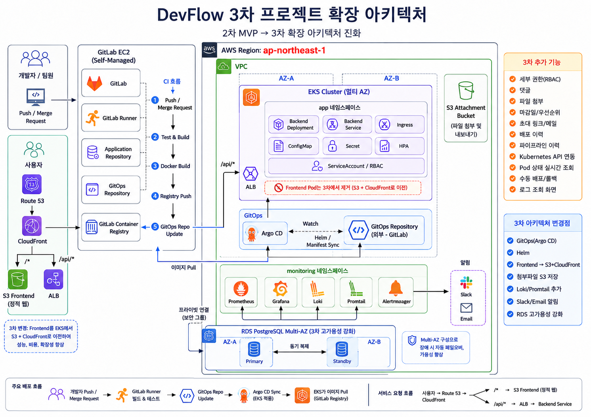

# DevFlow

> **협업이 처음이신가요?** 이슈 생성부터 PR 머지까지 전 과정은 [협업 가이드](./docs/GUIDE.md)를 먼저 읽어주세요.


> **프로젝트·업무 관리 화면 안에서 CI/CD, 배포, Kubernetes, 모니터링, 장애 상태까지 함께 보는 DevOps 통합 프로젝트 관리 시스템**

**DevFlow**는 프로젝트와 업무(Task)를 관리하면서, 관리 대상 서비스의 빌드·배포·운영 상태를 같은 화면에서 확인하도록 만든 서비스입니다.
2차 프로젝트에서 AWS EKS 위에 기본 기능을 올렸고, 3차 프로젝트에서는 GitHub Actions, Argo CD, Prometheus, Alertmanager, AWS 상태를 DevFlow 화면에 연결하고 온프레미스(kubeadm)와 AWS(EKS) 두 환경에 배포했습니다.

| 항목 | 내용 |
|------|------|
| 서비스 주소 | https://devflowlab.net (최종 시연 기준) |
| 기간 | 2차 2026.08 / 3차 2026.10.05 ~ 2026.11.13 |
| 최종 발표 | 2026.11.13 (녹화 시연) |
| 문서 최종 정리일 | 2026.11.17 |

---

## 2차 → 3차에서 달라진 점

| 영역 | 2차 | 3차 |
|------|-----|-----|
| Backend API | 13개 (회원, 프로젝트, 팀원, 업무) | **50개** (검색·페이지, 배포 이력, 장애, 파이프라인, 모니터링, 클라우드 연결, 소셜 로그인, 첨부파일) |
| CI/CD | Self-managed GitLab + Runner, kubectl 직접 배포 | **GitHub Actions + GHCR**, GitOps 저장소 태그 갱신 → **Argo CD + Helm** |
| Frontend 배포 | EKS Pod | **S3 + CloudFront** |
| Database | RDS PostgreSQL | **RDS PostgreSQL Multi-AZ**, Redis 캐시 |
| 운영 화면 | Grafana에서 따로 확인 | DevFlow 화면에서 파이프라인, 배포, Pod, HPA, 메트릭, 장애 확인 |
| 환경 | AWS EKS | **온프레미스 kubeadm 3노드 + AWS EKS**, Tailscale로 연결 |

---

## 팀 구성

| 이름 | 역할 | 3차 담당 | GitHub |
|------|------|----------|--------|
| 김석현 | 팀장 / Backend | Spring Boot API 50개, 연동 계층(GitHub Actions, Prometheus, AWS RDS·ALB, Argo CD·Alertmanager Webhook), 프로젝트별 클라우드 연결(AssumeRole), OAuth2, S3 첨부파일, Redis 캐시, 테스트와 배포 후 API 점검 | [@alberione1110](https://github.com/alberione1110) |
| 이주원 | Frontend | React UI, 파이프라인·배포·장애·모니터링·클라우드 연결 화면 | [@ssac-JW](https://github.com/ssac-JW) |
| 김민호 | AWS / Kubernetes | Terraform(VPC, EKS, RDS Multi-AZ, CloudFront + S3), Helm, Argo CD GitOps, HPA 검증 | [@KimMinHo-02](https://github.com/KimMinHo-02) |
| 최윤재 | 온프레미스 / 모니터링 | kubeadm 3노드 클러스터, Tailscale, Prometheus·Alertmanager, 백업·복구 | [@cheesemango1](https://github.com/cheesemango1) |

> 2차 프로젝트와 같은 팀원·주제로 이어서 진행했습니다.

---

## 주요 기능

| 기능 | 설명 |
|------|------|
| 회원·인증 | 회원가입, 로그인(JWT), GitHub·Google 소셜 로그인(1회용 code 교환) |
| 프로젝트·팀원 | 프로젝트 생성 시 생성자 OWNER 등록, OWNER만 팀원 등록, 멤버만 업무 접근 |
| 업무(Task) | 생성·수정·삭제, 상태와 담당자 변경, 검색·필터·정렬·페이지, 첨부파일(S3 Presigned URL) |
| CI/CD | GitHub Actions 파이프라인 단계별 상태 (Step 실행 결과 기준) |
| 배포 | Argo CD 배포 Webhook으로 배포 이력 기록 |
| Kubernetes | Deployment, Pod, Node, HPA 상태 |
| 모니터링 | Prometheus 기반 요청 수, 오류율, p95 응답 시간, CPU·메모리 요약과 추이 |
| 장애 | Alertmanager Webhook으로 장애 자동 생성, 확인·담당자 지정·해결, 종료 알림 후 자동 해결 |
| 클라우드 연결 | 프로젝트별 AWS 연결 (AssumeRole + ExternalId, Access Key 저장 없음), RDS·ALB 상태 |

API 전체 목록과 요청/응답 형식은 Wiki > [Backend API 구현 목록](https://github.com/Team-likelion-3rd-Project/likelion-devops-7th-3rd-team02/wiki/Backend-API-구현-목록)을 따릅니다.

---

## Architecture



**서비스 요청 흐름 (AWS)**

```text
사용자 -> Route 53 (devflowlab.net) -> CloudFront
  ├─ /                -> S3 (React Frontend)
  └─ /api/*, /oauth2/* -> ALB -> Amazon EKS (Spring Boot Backend)
                              ├─ RDS PostgreSQL (Multi-AZ)
                              ├─ Redis (캐시)
                              └─ S3 첨부파일 (IRSA)
```

**배포 흐름**

```text
개발자 -> GitHub (develop)
  -> GitHub Actions: Test / Build / Image Push (GHCR)
  -> GitOps 저장소 이미지 태그 갱신
  -> Argo CD Sync (Helm) -> Amazon EKS
  -> Argo CD 배포 Webhook -> DevFlow 배포 이력
Frontend: GitHub Actions -> S3 업로드 + CloudFront 캐시 무효화 (OIDC 임시 자격 증명)
```

**온프레미스 (dev)**: VirtualBox VM 3대(Control Plane 1, Worker 2), kubeadm, Calico, Traefik, Argo CD + Kustomize, Prometheus·Alertmanager. Tailscale로 AWS DevFlow와 연결해 온프렘 장애도 AWS 화면에서 확인합니다.

| 영역 | 기술 |
|------|------|
| Frontend | React, TypeScript, Vite, Tailwind CSS |
| Backend | Java 21, Spring Boot 3.5, Spring Data JPA, Spring Security(JWT, OAuth2), Flyway, AWS SDK |
| Database | PostgreSQL (Amazon RDS Multi-AZ), Redis |
| Infra | AWS (VPC, EKS, RDS, ALB, S3, CloudFront, Route 53, ACM), Terraform, Tailscale |
| CI/CD | GitHub Actions, GHCR, Argo CD, Helm, Kustomize |
| Monitoring | Spring Boot Actuator, Prometheus, Alertmanager, Grafana |
| 품질·보안 | JUnit, WireMock, k6, Trivy, Swagger / OpenAPI |

---

## 검증 결과

| 항목 | 결과 | 근거 |
|------|------|------|
| Backend 테스트 | 단위 테스트 104개 + Compose 통합 테스트 22단계 | CI `Compose Up & API Flow` |
| AWS 배포 후 API 점검 | 첫 실행 48개 중 46개 통과. 실패 2건(첨부 S3 미적용, 주체 ARN 누락)은 GitOps 값 수정 후 해결 | `scripts/aws-api-check.mjs` · Wiki [Backend 배포 설정](https://github.com/Team-likelion-3rd-Project/likelion-devops-7th-3rd-team02/wiki/Backend-배포-설정) |
| Redis 장애 시 모니터링 요약 | p95 10,300ms → 1,010ms(전환 직후) / 392ms(반복) | PR #44, #47 · Wiki [성능 테스트](https://github.com/Team-likelion-3rd-Project/likelion-devops-7th-3rd-team02/wiki/성능-테스트) |
| 온프렘 장애 → AWS DevFlow | 장애 주입부터 복구 확인까지 5분 39초 (전체 검증 구간, 알림 전송 지연 아님) | Wiki [장애 시나리오](https://github.com/Team-likelion-3rd-Project/likelion-devops-7th-3rd-team02/wiki/장애-시나리오) |
| EKS HPA | 실제 API 부하에서 2 → 4 확장, 부하 종료 후 4 → 2 축소 | [Kubernetes 테스트](./docs/kubernetes-test.md) |
| 이미지 취약점 | Spring Boot 3.5.4 → 3.5.16, Trivy CRITICAL 10 → 6건 | PR #56 · [이미지 스캔](./docs/security/image-scanning.md) |

**실행하지 못한 항목**: k6 `load`·`spike`·`hpa` 프로필은 스크립트와 목표만 작성했고 실측하지 못했습니다(CI에서는 `smoke`만 실행). 자세한 내용은 Wiki [성능 테스트](https://github.com/Team-likelion-3rd-Project/likelion-devops-7th-3rd-team02/wiki/성능-테스트)에 남겨 두었습니다.

---

## 저장소 구조

```text
.
├── backend/            Spring Boot API (Java 21, Gradle, Flyway)
├── frontend/           React + TypeScript + Vite
├── helm/               DevFlow Helm Chart, 모니터링 Chart
├── gitops/             GitOps 저장소 seed (Argo CD Application)
├── k8s/                Kubernetes 매니페스트 (2차 EKS 매니페스트, 컨트롤러, 온프렘 bootstrap·overlay)
├── terraform/          AWS 인프라 (modules/, environments/)
├── monitoring/         Grafana 대시보드
├── scripts/            GitOps 릴리스·롤백, Frontend S3 배포, 배포 후 API 점검, k6 부하 테스트
├── postman/            Backend API 통합 테스트 컬렉션
├── docs/               설계 문서, 이관 기록, 런북, 검증 기록
├── .github/workflows/  CI, 이미지 빌드, 릴리스·롤백, Frontend 배포
└── .gitlab-ci.yml      2차 GitLab 파이프라인 (기록용, 3차에서는 사용하지 않음)
```

---

## Documentation

상세 설계·운영 기록은 **[GitHub Wiki](https://github.com/Team-likelion-3rd-Project/likelion-devops-7th-3rd-team02/wiki)** 에서 관리합니다.

| 카테고리 | 문서 |
|----------|------|
| **Architecture** | System Architecture · ON1 온프레미스 설계 · ERD · API Specification · Backend API 구현 목록 |
| **운영** | 배포 가이드 · 배포 절차 · Backend 배포 설정 · 장애 시나리오 · 성능 테스트 · 트러블슈팅 |

저장소 안의 문서:
[AWS·Kubernetes 설계](./docs/architecture.md) ·
[Terraform 아키텍처](./terraform/docs/architecture.md) ·
[Kubernetes 테스트](./docs/kubernetes-test.md) ·
[GitLab → GitHub Actions 이관](./docs/migration/gitlab-to-github-actions.md) ·
[관측 런북](./docs/migration/observability-runbook.md) ·
[이미지 스캔](./docs/security/image-scanning.md) ·
[2차 → 3차 이관 기록](./docs/migration/2nd-to-3rd.md)

---

## 범위와 한계

- **구현하지 않은 항목**: 프로젝트 수정·삭제, 팀원 제거·역할 변경, 토큰 갱신·로그아웃, GitHub 이슈·PR 연동, GitLab 연결, 비용 조회 ([범위 결정](https://github.com/Team-likelion-3rd-Project/likelion-devops-7th-3rd-team02/wiki/Backend-API-구현-목록))
- **운영 범위**: 교육용 프로젝트로, 실제 사용자 대상 운영은 하지 않았습니다. AWS 환경은 최종 시연용입니다.

---

## 보안과 개인정보 경계

이 저장소는 공개 저장소입니다. 다음 정보를 절대 포함하지 않습니다.

- AWS Access Key, GitHub Token, JWT Secret, `.env` 실제 값, 인증서·키 파일
- 실제 사용자 개인정보, 운영 DB 계정 정보
- 내부 인프라 식별자 및 서버 직접 접근 URL

비밀값은 GitHub Actions Secrets/Variables와 Kubernetes Secret으로 주입합니다. AWS 접근은 장기 Access Key 대신 GitHub Actions OIDC, IRSA, AssumeRole을 사용합니다.
비밀값이 실수로 커밋되면 GitHub이 push를 차단합니다. 이미 커밋된 경우 **즉시 해당 키를 폐기하고 재발급**하세요. 커밋을 되돌리는 것만으로는 이력에 남습니다.

---

## 로컬 실행

**사전 요구사항:** JDK 21, Node 22+, Docker / Docker Compose

### 한 번에 실행 (docker compose)

PostgreSQL, Backend, Frontend를 컨테이너로 함께 띄웁니다.

```bash
cp .env.example .env   # DB_PASSWORD, JWT_SECRET(32자 이상) 채우기
docker compose up -d --build
```

- 서비스: `http://localhost:3000` (Nginx가 `/api`를 Backend로 전달)
- Swagger: `http://localhost:8080/swagger-ui.html`
- 종료: `docker compose down` (DB 데이터까지 지우려면 `docker compose down -v`)

### 개별 실행 (개발용)

**Database (PostgreSQL)**

```bash
cd backend
docker compose up -d
```

**Backend**

```bash
cd backend
./gradlew bootRun      # Windows: .\gradlew.bat bootRun
```

`local` 프로필은 docker compose의 PostgreSQL 접속 정보를 기본값으로 사용합니다.
값을 바꾸려면 `backend/.env.example`의 변수를 환경변수로 지정합니다. (`.env` 파일은 자동으로 읽지 않습니다)

**Frontend**

```bash
cd frontend
npm install
npm run dev
```

- backend: `http://localhost:8080`
- Swagger: `http://localhost:8080/swagger-ui/index.html`
- frontend: `http://localhost:3000` (`/api` 요청은 8080으로 프록시)

**검증**

```bash
cd backend && ./gradlew test
cd frontend && npm run build
```

---

## 기여 방법

- **규칙 요약** — [CONTRIBUTING.md](./CONTRIBUTING.md)
- **실행 방법 상세** — [협업 가이드](./docs/GUIDE.md)

## License

이 프로젝트는 [MIT License](./LICENSE) 를 따릅니다.
